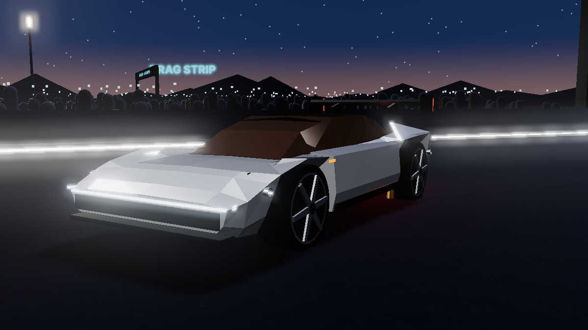
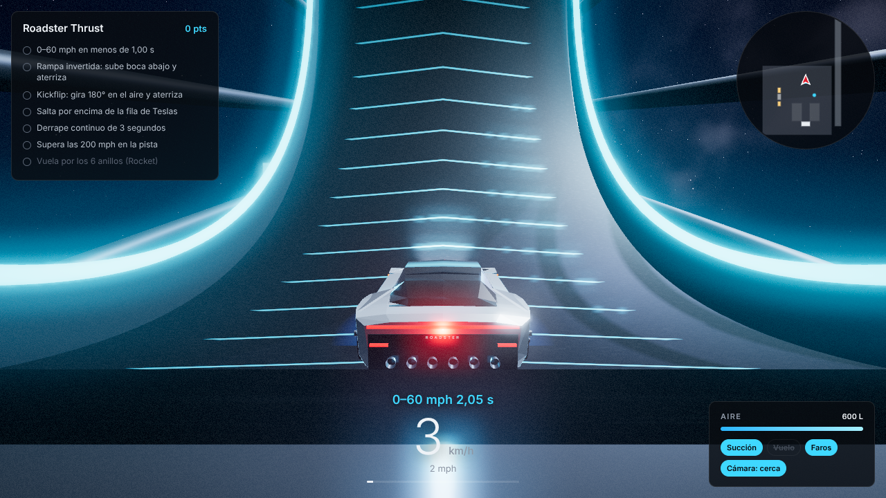
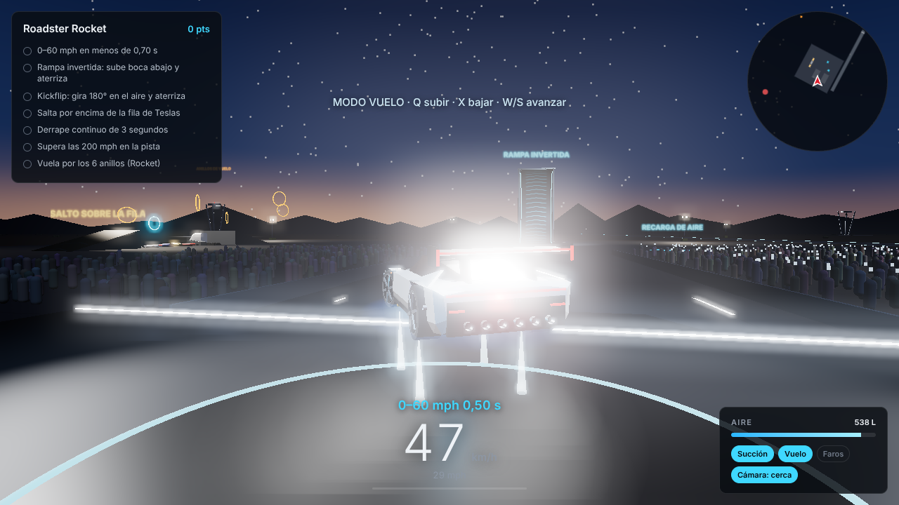
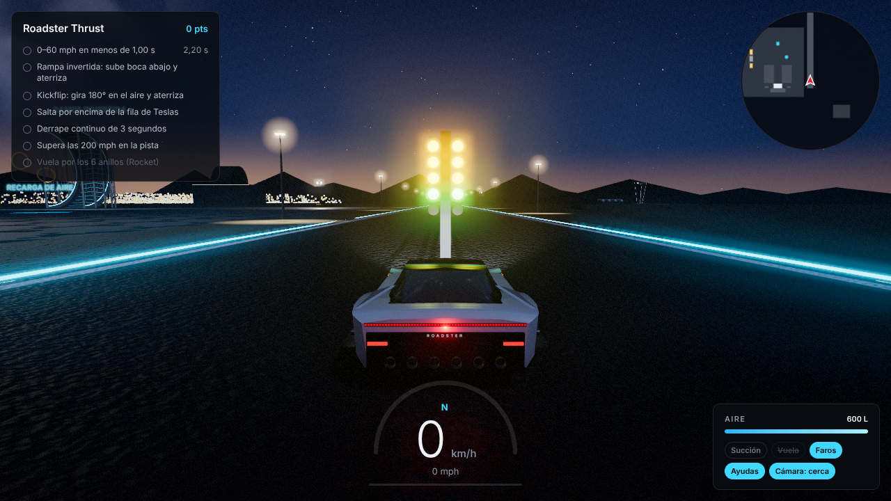
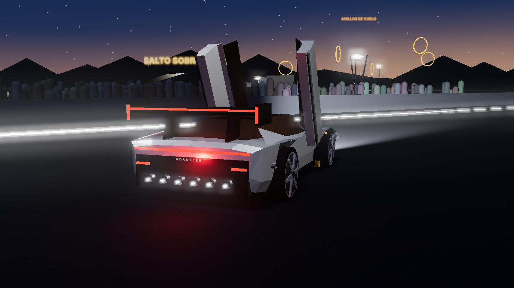

# Roadster: McGregor Reveal

Juego 3D en tercera persona del nuevo **Tesla Roadster** (presentado el 15 de octubre de 2026), ambientado en el lugar donde se presentó: el sitio de pruebas de cohetes de **SpaceX en McGregor, Texas**, de noche.

> Juego de fans no oficial, sin relación con Tesla ni SpaceX. Las cifras vienen de la prensa sobre la presentación y pueden cambiar.



## Cómo jugar

**Lo más fácil:** descarga [`dist/Roadster.html`](dist/Roadster.html) y ábrelo con doble clic. Es un único archivo con todo dentro (también el motor 3D), así que funciona sin instalar nada y sin internet. Usa Chrome, Edge o Firefox actualizados.

Otras opciones:
- **GitHub Pages:** en *Settings → Pages*, elige *Deploy from a branch*, la rama y la carpeta `/ (root)`. Tendrás un enlace para jugar desde el navegador o el móvil.
- **Desde el código fuente:** ejecuta `python3 -m http.server 8000` en la carpeta y abre `http://localhost:8000`. El `index.html` no funciona con doble clic porque usa varios archivos de JavaScript.
- **Volver a generar el archivo único** tras cambiar el código: `npm install` y después `npm run build`.

## Lo que hay en el juego

### El coche y sus habilidades
| Habilidad | Tecla | Detalle |
|---|---|---|
| Aceleración real por versión | `W` | 0–60 mph en 1,6 s (Performance), 0,9 s (Thrust) o 0,59 s (Rocket), con impulso |
| Ventilador de succión | `E` | Hasta 2G de carga aerodinámica: más agarre y circular **boca abajo** |
| Propulsores de gas frío | `Shift` | Impulso con aire comprimido (depósito de 600 L, se recarga solo o en la zona de recarga) |
| Salto con propulsores | `Q` | Salto vertical; mantenido en el aire: elevación |
| Control en el aire | `A` `D` / `W` `S` / `←` `→` | Alabeo (kickflip), cabeceo (mortales) y guiñada |
| Modo vuelo (solo Rocket) | `F`, `Q` subir, `X` bajar | Despega, flota y vuela con los propulsores |
| Freno de mano / derrape | `Espacio` | |
| Faros | `L` | Ocultos en la barra de luz delantera |
| Puertas de mariposa | `O` | Se abren hacia arriba con el coche parado |
| Panel del techo de cristal | `G` | Quitar / poner |
| Cámaras en tercera persona | `C` | Cerca, lejos y cine (cámaras de retransmisión). Arrastra el ratón para orbitar |
| Otros | `H` claxon · `R` reaparecer · `U` km/h↔mph · `M` silencio · `Esc` pausa · `I` ayuda | |

También funciona con **mando** (RT/LT, stick, A salto, B derrape, X succión, Y vuelo, RB impulso) y con **controles táctiles** en el móvil.

### Las tres versiones
| | Performance | Thrust | Rocket |
|---|---|---|---|
| 0–60 mph | < 1,6 s | < 0,9 s | < 0,59 s |
| Velocidad máxima | 214 mph | 214 mph | 230+ mph |
| Propulsores | — | Gas frío | 10 toberas, 600 L |
| Vuelo | — | Saltos | Sí |
| Plazas | 2+2 | 2+2 | 1 |
| Reserva | 50.000 $ | 250.000 $ | Por invitación |

### El entorno (SpaceX McGregor, de noche)
- **Escenario de la presentación** con la gran estructura en arco, pantalla LED en directo, plataforma giratoria, humo, focos y reflectores barriendo el cielo, y cuenta atrás de lanzamiento.
- **Público** a ambos lados del pasillo, con luces de móviles; se anima cuando haces algo espectacular.
- **Rampa invertida:** la rampa curva de la demo. Súbela con la succión hasta quedar boca abajo, sal volando y gira 180° para aterrizar sobre las ruedas.
- **Salto sobre la fila de Teslas:** Model 3, Model Y, Cybercab, Model S, Cybertruck y Semi.
- **Pista de aceleración** con semáforo de salida, cronómetro de 0–60 mph y de 1/4 de milla.
- **Bancos de pruebas de cohetes** con motores Raptor que hacen encendidos estáticos, un Starship iluminado y **anillos de vuelo** para la versión Rocket.
- **Zona de recarga de aire comprimido.**

### Retos
0–60 por debajo del objetivo de tu versión · rampa invertida con aterrizaje · kickflip · saltar la fila · derrape de 3 s · superar 200 mph · atravesar los 6 anillos volando (Rocket). Los récords se guardan en el navegador.

| | |
|---|---|
|  |  |
|  |  |

## Lo que se sabe del nuevo Roadster (investigación, oct. 2026)
- **Presentación:** 15 de octubre de 2026, de noche, en el sitio de pruebas de SpaceX en McGregor (cerca de Waco, Texas). Hubo arco escénico, humo, música, siseos mecánicos y cuenta atrás.
- **Demos:** subió por una rampa curva gigante pegado por la succión hasta quedar invertido, salió volando, giró 180° con los propulsores y aterrizó. En otra prueba saltó una fila de Teslas, incluidos un Cybertruck y un Semi. Las acrobacias se hicieron sin nadie dentro.
- **Prestaciones:** se mostró un 0–60 mph grabado en 0,81 s (sin verificar de forma independiente). 1.341 hp y más de 300 millas de autonomía según las cifras publicadas.
- **Tecnología:** ventilador bajo el coche con hasta 2G de carga, propulsores de gas frío (aire comprimido, no queman combustible), carrocería angulosa de caras planas, techo de cristal tintado de una pieza, barra de luz delantera, puertas de mariposa, llantas de 6 radios, yoke steer-by-wire y, en el Rocket, alerón trasero y batería de toberas.
- **Producción:** prevista para 2028. Precio final sin confirmar; el sistema de vuelo del Rocket no está aprobado para vías públicas.

Fuentes: [CNBC](https://www.cnbc.com/2026/10/15/tesla-roadster-reveal-what-to-know-about-the-delayed-ev.html) · [Fox News](https://www.foxnews.com/tech/tesla-roadster-flies-flips-hits-60-mph-flash) · [Fox Business](https://www.foxbusiness.com/technology/teslas-new-roadster-makes-flying-debut-hitting-60-mph-under-second) · [Deseret News](https://www.deseret.com/business/2026/10/16/new-tesla-roadster-flies-several-meters-in-the-air-at-texas-exhibition) · [InsideEVs (demo)](https://insideevs.com/news/812151/2027-tesla-roadster-price-specs-release-date/) · [InsideEVs (ficha)](https://insideevs.com/news/812242/tesla-roadster-2026-specs/) · [Motor1](https://www.motor1.com/news/812195/tesla-roadster-stunt-2028-production/) · [The Next Web](https://thenextweb.com/news/tesla-roadster-reveal-thrusters-2028) · [CarBuzz](https://carbuzz.com/new-tesla-roadster-debut-features-specs/) · [Click2Houston](https://click2houston.com/news/local/2026/10/16/tesla-unveils-new-roadster-with-rocket-style-thrusters-targets-2028-production) · [Tech Insider](https://tech-insider.org/tesla-roadster-tricks-stunts-explained-2026/)

## Estructura del código
```
index.html        página, menú y HUD
css/style.css     estilos
js/main.js        bucle del juego, cámara, retos, HUD, minimapa
js/world.js       entorno de McGregor (escenario, rampas, pista, cohetes…)
js/car.js         modelo 3D del Roadster y de los otros Teslas
js/physics.js     física: conducción, succión, propulsores, saltos y vuelo
js/input.js       teclado, mando y táctil
js/audio.js       sonido generado (motor eléctrico, propulsores, público)
js/particles.js   humo, vapor de los propulsores, chispas y fuegos artificiales
js/geom.js        utilidades de geometría y texturas
```
